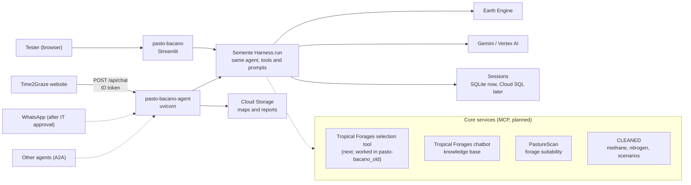

# Pasto Bacano

This file covers Pasto Bacano only. The original Pasto10 documentation is in [README.md](README.md).

Pasto Bacano is the Time2Graze decision support system, focused on Colombia for now, deployed on Google Cloud Run. Replace `PROJECT_ID` and `REGION` (for example `us-central1`) in the commands below. Blocks marked `shell` work in both PowerShell and bash; the others are specific to the shell they are marked with.

## Deployment

### 1. Set up Google Cloud (once)

1. Select the project:

   ```shell
   gcloud config set project PROJECT_ID
   ```

2. Enable the APIs:

   ```shell
   gcloud services enable earthengine.googleapis.com run.googleapis.com cloudbuild.googleapis.com artifactregistry.googleapis.com secretmanager.googleapis.com
   ```

3. Register the project for Earth Engine at https://code.earthengine.google.com/register.

4. Create the service account the app runs as:

   ```shell
   gcloud iam service-accounts create pasto-bacano
   ```

5. Give it access to Earth Engine and to secrets:

   ```shell
   gcloud projects add-iam-policy-binding PROJECT_ID --member serviceAccount:pasto-bacano@PROJECT_ID.iam.gserviceaccount.com --role roles/earthengine.viewer
   gcloud projects add-iam-policy-binding PROJECT_ID --member serviceAccount:pasto-bacano@PROJECT_ID.iam.gserviceaccount.com --role roles/serviceusage.serviceUsageConsumer
   gcloud projects add-iam-policy-binding PROJECT_ID --member serviceAccount:pasto-bacano@PROJECT_ID.iam.gserviceaccount.com --role roles/secretmanager.secretAccessor
   ```

6. Ask WRI to share the Time2Graze biomass asset (`projects/wri-lcl-time2graze/assets/ugpp_prod_10m_v1`) with `pasto-bacano@PROJECT_ID.iam.gserviceaccount.com`.

7. Create a Gemini API key at https://aistudio.google.com/apikey, save it in a file `key.txt`, store it as a secret and delete the file:

   ```shell
   gcloud secrets create gemini-api-key --data-file=key.txt
   ```

**Note:** never paste keys into chats or commits. If a key is exposed, create a new one, delete the old one and run `gcloud secrets versions add gemini-api-key --data-file=key.txt`.

### 2. Deploy to Cloud Run

From the repository folder:

```shell
gcloud run deploy pasto-bacano --source . --region REGION --service-account pasto-bacano@PROJECT_ID.iam.gserviceaccount.com --port 8501 --memory 2Gi --timeout 3600 --session-affinity --max-instances 1 --set-env-vars APP_ENV=development,GEE_PROJECT=PROJECT_ID --set-secrets GOOGLE_API_KEY=gemini-api-key:latest --no-allow-unauthenticated
```

Open it with `gcloud run services proxy pasto-bacano --region REGION` and go to http://localhost:8080.

On Cloud Run, Earth Engine uses the service account directly, so no key file is needed. For now sessions are kept inside the instance and are lost when it restarts; Cloud SQL will replace this.

### 3. Run locally

No key file is needed: you sign in as the service account instead (service account keys are blocked in this project).

1. Allow your account to act as the service account (once):

   ```shell
   gcloud iam service-accounts add-iam-policy-binding pasto-bacano@PROJECT_ID.iam.gserviceaccount.com --member user:YOUR_EMAIL --role roles/iam.serviceAccountTokenCreator
   ```

2. Sign in as the service account (opens the browser once):

   ```shell
   gcloud auth application-default login --impersonate-service-account pasto-bacano@PROJECT_ID.iam.gserviceaccount.com
   ```

3. Create `.env` and leave `GEE_SERVICE_ACCOUNT` and `GEE_KEY_FILE` empty:

   ```dotenv
   GOOGLE_API_KEY="your Gemini key"
   GEE_PROJECT="PROJECT_ID"
   GEE_SERVICE_ACCOUNT=""
   GEE_KEY_FILE=""
   ```

4. Install, check Earth Engine and start the chat:

   ```shell
   uv sync --python 3.14
   uv run python scripts/check_gee.py
   ```

   Start the chat in PowerShell:

   ```powershell
   .\scripts\run_local.ps1 -TestPicker
   ```

   If PowerShell says running scripts is disabled, use:

   ```powershell
   powershell -ExecutionPolicy Bypass -File .\scripts\run_local.ps1 -TestPicker
   ```

   or in bash:

   ```bash
   PASTO10_TEST_PICKER=1 scripts/run_local.sh
   ```

   The chat opens at http://localhost:8501.

## Developing

### 1. Agent as an API endpoint (planned)

**Status:** design only, not built yet. It adds a second way to run the same agent; the Streamlit setup above stays as it is, and Semente is not modified.

The same repository and container image run as two Cloud Run services, started with different commands:

| Service | Start command | Used by |
| --- | --- | --- |
| `pasto-bacano` (current) | Streamlit | People testing in the browser |
| `pasto-bacano-agent` (new) | uvicorn (web API) | Time2Graze website, later WhatsApp and other agents |



The core services connect to the agent, not to the API or Streamlit, so both ways in can use them. TF Data Explorer is left out because the website links to it directly.

**Endpoints**

- `POST /api/chat`: receives `{session_id, message, language}` and returns `{reply, attachments}`, the contract the Time2Graze website already uses.
- `GET /api/health`: health check.
- A2A (optional): Semente 0.4.1 already includes it; adding `a2a` to `channels` in `semente.yaml` exposes it on the same service.
- WhatsApp webhook: mounted on the same service by Semente once the WhatsApp API is approved.

**Design points**

- **Access:** private service with Cloud Run IAM; the website calls it with an ID token, which it already supports.
- **Maps and reports:** tools return images and PDFs as bytes. The API uploads them to Cloud Storage and returns short lived signed `https` links (the website only shows `https` links).
- **Sessions:** SQLite in one instance at first, Cloud SQL later so the service can scale.
- **Response time:** map and biomass answers can take 30 to 90 seconds (the website waits up to 90); streaming can come later.
- **Language:** the agent already answers in the user's language; the `language` field is accepted and used as a hint.

**What will be added:** `app/api.py` (the endpoints), `app/main.py` (the web app), tests, and a second deploy command that only changes the start command.

### 2. Farm registration in Colombia (planned)

Colombia has no equivalent of Brazil's CAR (a public boundary for almost every rural property). In Colombia "CAR" means *Corporación Autónoma Regional*, a different thing.

| Source | What it gives | Access |
| --- | --- | --- |
| IGAC cadastre | Parcel boundary by 30 digit *número predial* | Open data per municipality; some places (Bogotá, Antioquia, Medellín, Cali) run their own cadastre. Coverage and age vary; to be confirmed |
| ICA (SIGMA) and Fedegán | Registered livestock farms (*predios pecuarios*) with location | Needs a data agreement |
| SNR | Legal ownership, no maps | Paid certificates; not useful for boundaries |
| ANT | Titling of state land | Specific cases only |

Context layers (no farm identity): UPRA agricultural frontier and cattle suitability, RUNAP protected areas, IDEAM deforestation, MapBiomas Colombia (already in GEE).

**Plan**

1. **Now:** pin with radius, or uploaded or drawn polygon (already supported).
2. **Next:** look up the IGAC parcel by *número predial*, as a new property source, starting with the target municipalities in the Llanos and Caribe.
3. **Later:** ICA and Fedegán farm registry, if CIAT gets a data agreement.

### 3. Customizing the agent

Semente runs the conversation and is not modified. What the agent knows and does lives in `domain/` and `semente.yaml`.

**Change freely**

| Part | Where | For Pasto Bacano |
| --- | --- | --- |
| Main instructions | `domain/prompts/agents.yml` (`single_agent`) | Name, Colombia focus, operational, tactical and strategic decisions |
| Helper agent prompts | `agents.yml` (welcoming, summary, persona, remediation, satisfaction, image description) | Wording and branding (Semente's agents, overridable here) |
| Tool texts | `domain/prompts/tools.yml` | When to use each tool |
| Tools | `domain/tools/`, registered in `domain/agent.py` | Core services, Colombian farm registration, biomass trend |
| Skills | `domain/skills/livestock/` | Procedures: grazing thresholds, feed budget, Llanos and Caribe systems |
| Guardrails | `domain/guardrails.py` | Colombian IDs (cédula, NIT) |
| Terms | `domain/terms.md` | Pasto Bacano and Alliance/CIAT terms |
| Manifest | `semente.yaml` | Name, models, channels, features |

**Avoid**

- Changing Semente's code: add to `domain/` or `app/`, or propose a pull request to LAPIG.
- Splitting into many agents: keep one agent, with procedures in skills, data in tools and external agents (such as the Tropical Forages chatbot) called as tools.
- Renaming or removing prompt keys: change the text, not the keys.
- Writing instructions in Spanish: keep them in English (a test checks this); the agent answers in the user's language.
- Rewriting the registration state machine in `domain/agent.py`: extend it.

**Principles**

1. Numbers come from tools, with their source, never from the model.
2. Skills hold the rules, tools hold the data.
3. Each answer states its timescale and confidence; satellite data complements field checks.
4. Add one capability at a time and test it on Llanos and Caribe farms.
5. `interaction-assessment` stores conversations for evaluation by default: decide whether to keep it and say so in the terms.

### 4. Databases and storage

| Data | Google Cloud service | When |
| --- | --- | --- |
| Sessions, history, farms, terms | Cloud SQL for PostgreSQL | Before real users |
| Own knowledge base (optional) | pgvector in the same Cloud SQL | If needed |
| Maps, PDFs, videos from the API | Cloud Storage, signed links | With the API |
| WhatsApp message queue | Memorystore for Valkey | With WhatsApp |
| IGAC parcels | BigQuery or PostGIS | With the IGAC lookup |
| Usage analysis | BigQuery | Later |
| Keys and passwords | Secret Manager | Now |

**Notes**

- Semente supports only SQLite and Postgres, so use Cloud SQL Postgres.
- Connect Cloud Run to Cloud SQL through a private IP (Direct VPC egress) or the Cloud SQL Auth Proxy sidecar; Semente builds a `host:port` URL, so the Cloud SQL socket does not work.
- Semente logs in with a password: keep it in Secret Manager.
- `APP_ENV=production` requires the `S3_*` variables, but nothing uses S3: placeholders are enough.
- Streamlit and the API can share the same database.

### 5. Channels: website and WhatsApp

Both connect to the `pasto-bacano-agent` service once it is deployed (section 1).

**External website** (the Time2Graze website, also on Cloud Run)

1. Deploy the website with `AGENT_URL=https://<agent service URL>` and `AGENT_AUTH=idtoken`.
2. Allow the website's service account to call the agent:

   ```shell
   gcloud run services add-iam-policy-binding pasto-bacano-agent --region REGION --member serviceAccount:WEBSITE_SA --role roles/run.invoker
   ```

The agent stays private; the website calls `POST /api/chat` with an ID token. A website outside Google Cloud would use an API key instead (`AGENT_AUTH=apikey`).

**WhatsApp** (after IT approval of the WhatsApp Business API)

1. In Meta for Developers, create the app and the WhatsApp number.
2. Store `WHATSAPP_ACCESS_TOKEN`, `WHATSAPP_VERIFY_TOKEN` and `WHATSAPP_APP_SECRET` in Secret Manager, and set `WHATSAPP_PHONE_NUMBER_ID`.
3. Add Memorystore for Valkey and set `VALKEY_HOST`, `VALKEY_PORT` and `VALKEY_DB`.
4. In Meta, set the webhook to `https://<agent service URL>/whatsapp/webhook` with the same verify token, and subscribe to `messages`.

**Note:** Meta cannot send a Google ID token, so the webhook must be public. It is protected by Meta's signature (`WHATSAPP_APP_SECRET`). Either run WhatsApp as a separate public service from the same image, or make the agent public and protect `/api/chat` with an API key.

### 6. Next steps

**Setup**

- [x] Fork Pasto10 as pasto-bacano
- [x] Configure the Google Cloud project and Earth Engine
- [ ] Test locally (chat, maps, biomass, weather, in Spanish)
- [ ] Test on Cloud Run
- [ ] Switch from the Gemini API key to Vertex AI

**Pasto Bacano identity and Colombia**

- [ ] Rename Pasto10 to Pasto Bacano in `domain/prompts/` and `domain/terms.md`
- [ ] Add Colombian test farms (Llanos Orientales, Caribe)
- [ ] Register farms by pin and radius or uploaded polygon (Colombia has no CAR)
- [ ] Use Colombian data and thresholds (MapBiomas Colombia, local grazing thresholds)

**Core services** (from pasto-bacano_old and the Time2Graze design)

- [ ] Tropical Forages selection tool (MCP, already used in pasto-bacano_old): `https://tf-selection-tool-mcp-283437872147.us-central1.run.app/mcp`
- [ ] Tropical Forages chatbot (knowledge base): confirm its API or MCP
- [ ] TF Data Explorer: link from the website first, tool later
- [ ] PastureScan (forage suitability)
- [ ] CLEANED (methane, nitrogen, scenarios): needs an MCP or API

**Decision support**

- [ ] Operational: entry and exit biomass thresholds and move date
- [ ] Tactical: feed budget from the 8 week biomass trend and herd size
- [ ] Strategic: forage and system scenarios (Tropical Forages, CLEANED, system dynamics)

**Website and production**

- [ ] Add a `/api/chat` endpoint so the Time2Graze website can talk to the agent
- [ ] Deploy the Time2Graze website on Cloud Run, connected to the agent
- [ ] Cloud SQL for sessions and Cloud Storage for maps and reports, then `APP_ENV=production`

**WhatsApp** (waits for IT approval of the WhatsApp API)

- [ ] Get WhatsApp Business API approval
- [ ] Enable the WhatsApp webhook on Cloud Run and add Memorystore (Valkey)
